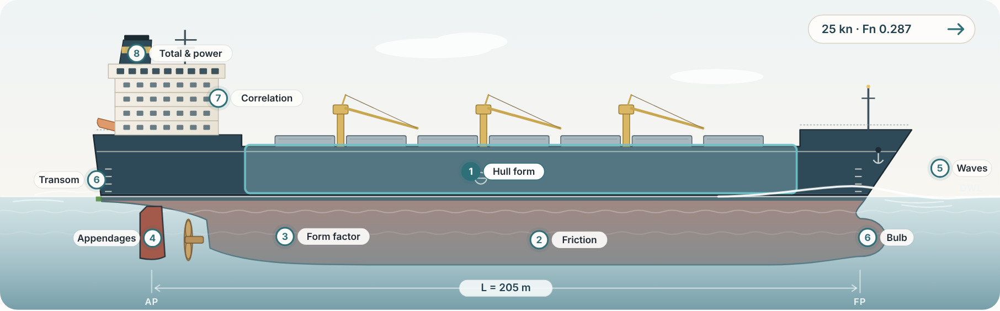

# Holtrop–Mennen Resistance Calculator

An interactive web app that estimates the calm-water resistance and effective power of a displacement ship using the **Holtrop–Mennen (1982)** regression method, which was fitted to MARIN model tests and full-scale trials.



The ship's sheer profile carries a numbered marker for each of the method's eight steps: the main hull (hull form), the wetted hull (friction), the afterbody run (form factor), the rudder and propeller (appendages), the bow wave (waves), the bulb and transom, the superstructure (correlation) and the funnel / speed tag (total and power). Hover a marker to preview that step's values; click it to enter its inputs and see what it computes. Results update instantly:

- **Total resistance** $R_T$ and **effective power** $P_E = R_T V$ at the design speed, with a breakdown of the six components
- A **resistance or power curve** over a speed range you choose, as a chart, as a table, or as a CSV download
- The **eight-step calculation trace**, with every formula, intermediate coefficient and branch condition ($c_7, c_{12}, c_{15}, c_{16}, \lambda, c_4, c_6$)
- **Validity checks** against the ship-type ranges the regression was fitted to

$$R_T = R_F(1+k_1) + R_{APP} + R_W + R_B + R_{TR} + R_A$$

## The eight steps

| Step | What | Key outputs |
|---|---|---|
| 1 | Hull form | $C_B, C_P, F_n, L_R$ |
| 2 | Friction (ITTC-1957) | $S, R_n, C_F, R_F$ |
| 3 | Form factor | $c_{12}, c_{13}, 1+k_1$ |
| 4 | Appendages | $(1+k_2)_{eq}, R_{BT}, R_{APP}$ |
| 5 | Wave making | $c_1, c_2, c_3, c_5, c_7, i_E, m_1, m_2, \lambda, R_W$ |
| 6 | Bulb and transom | $P_B, F_{ni}, R_B, F_{nT}, c_6, R_{TR}$ |
| 7 | Correlation allowance | $c_4, C_A, R_A$ |
| 8 | Total and power | $R_T, P_E$ |

The 1982 formula set is used throughout, and the 1984 revisions are not mixed in. Speeds are converted with 1 kn = 0.5144 m/s. The wetted surface $S$ and the half angle of entrance $i_E$ come from the regression unless you enter your own values.

## Verification

`src/engine/holtrop.test.ts` checks every intermediate value against the worked example in the 1982 paper ($L = 205$ m, $B = 32$ m, $T = 10$ m, $\nabla = 37\,500$ m³, 25 kn):

| | This app | Reference |
|---|---|---|
| $R_F(1+k_1)$ | 1005.5 kN | 1005.5 kN |
| $R_W$ | 556.7 kN | 556.7 kN |
| $R_A$ | 220.5 kN | 220.5 kN |
| $R_T$ | 1791.6 kN | 1791.6 kN |
| $P_E$ | 23 040 kW | 23 040 kW |

It also reproduces the full 15–29 kn curve to within 0.3 %.

## Project structure

```
src/
  engine/
    holtrop.ts        Pure calculation engine (8 steps, all branch conditions)
    types.ts          Input and result types
    presets.ts        Worked example, bulk carrier, appendage 1+k2 table
    validity.ts       Input errors and fitted-range checks
    holtrop.test.ts   Vitest suite against the 1982 worked example
  components/
    ShipDiagram.tsx   Interactive SVG sheer profile with the eight steps as hotspots
    ZonePanel.tsx     Inputs and outputs for the selected step
    Results.tsx       R_T / P_E summary, component breakdown, checks
    SpeedCurve.tsx    Resistance or power curve, table and CSV export
    Steps.tsx         Eight-step trace with KaTeX formulas
  zones.ts            Steps 1–8 → ship hotspot, input fields, resistance components
  App.tsx             State, persistence (localStorage and share links)
```

Stack: React 19, TypeScript, Vite, Tailwind CSS 4, Recharts and KaTeX.

## Run locally

```bash
npm install
npm run dev      # http://localhost:5173
npm test         # engine tests
npm run build    # production build in dist/
```

## Deploy on Vercel

This repo includes `vercel.json` (Vite framework, `npm run build`, output `dist`).

**From the dashboard:** go to [vercel.com/new](https://vercel.com/new), import this GitHub repository and press Deploy. Vercel detects the settings automatically. Every push to `main` then redeploys to production, and every pull request gets a preview URL posted back to GitHub.

**From the CLI:**

```bash
npm i -g vercel
vercel          # first run links the project
vercel --prod
```

## Limits of the method

| Ship type | Max $F_n$ | $C_P$ | $L/B$ | $B/T$ |
|---|---|---|---|---|
| Tankers, bulk carriers | 0.24 | 0.73–0.85 | 5.1–7.1 | 2.4–3.2 |
| Trawlers, coasters, tugs | 0.38 | 0.55–0.65 | 3.9–6.3 | 2.1–3.0 |
| Container ships, destroyers | 0.45 | 0.55–0.67 | 6.0–9.5 | 3.0–4.0 |
| Cargo liners | 0.30 | 0.56–0.75 | 5.3–8.0 | 2.4–4.0 |
| Ro-ro ships, car ferries | 0.35 | 0.55–0.67 | 5.3–8.0 | 3.2–4.0 |

Outside these ranges, or for unusual hull forms, treat the result as a rough guide only. The app warns you when this happens.

## Reference

Holtrop, J. and Mennen, G.G.J. (1982). *An approximate power prediction method.* International Shipbuilding Progress, 29(335), 166–170.
